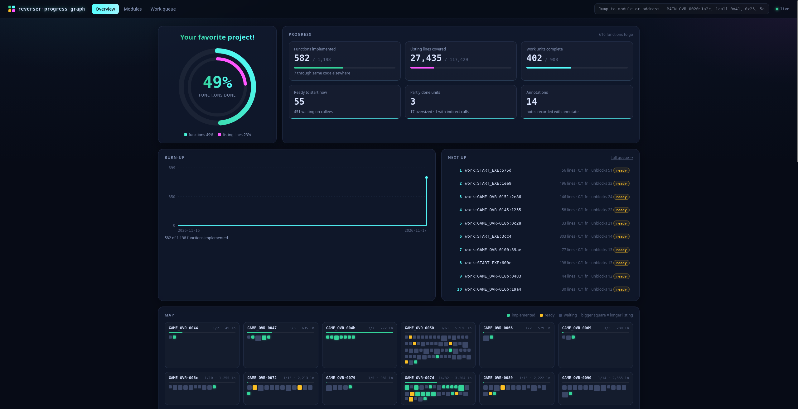

# reverser-progress-graph

An MCP server for keeping smaller language models on track while they reimplement an old 16-bit MS-DOS program: 
one function at a time, from a call graph of its original executables. 

This server ships with an example graph builder with its own embedded decompiler and reference hunter that produces 
that call graph from the binaries. It won't work for every game, and it won't necessarily work for your project, but
the news is good: it also ships a document that explains the methodology in Claude-ish, so you can build a new one
from this template using your own agents.



## What the MCP server is for

Reimplementing a DOS program with LLM agents goes wrong in predictable ways: the model drowns in a huge disassembly,
loses its place, invents what a function does, reads `21` as decimal, works on the wrong function, or claims work is
done that isn't. The server gives agents a small, structured way through the program instead:

- **One bite-sized job at a time.** `next_work` splits the unimplemented call graph into work units (a function plus
  the helpers that only it uses), ranked so that every unit it offers calls nothing still unimplemented. The agent 
  always knows what to do next and what "done" means, and has enough information to tell you what went wrong when 
  something inevitably does.
- **Short answers, detail on demand.** `module` gives a function's callers, callees, call chains and status in a few
  lines; full listings, traces and plans are MCP Resources which the agent reads only when it needs them. Small 
  models with small context windows don't get smothered with too much context, and never get lost in the weeds trying 
  to answer questions.  Double this gain by telling even the small models to run traces in subagents, and preserve
  your main context window.
- **Listings that point the way.** Every call in a listing names its target (`; → MAIN_OVR-0041:0100`), so the agent
  follows the program by name instead of doing address arithmetic. What the graph cannot name says why:
  `unresolved (indirect)`, with the reason and how to translate it. Your lightweight models might get stuck here, but
  your frontier orchestrator should be able to reason its way out of the trap.
- **Globals with their readers and writers.** `data_references` takes a data address (`ds:4f2a`, or `[0x4f2a]` pasted
  from a listing) and names every instruction that writes it, reads it, calls through it or takes its address, so the
  agent asks "who sets this flag?" instead of searching listings.
- **Reference lookups built in.** `interrupts`, `dos_port` and `dos_memory_offset` explain `INT 21h AH=3Dh`,
  `OUT 3C8h` or `B800:0000` for the registers in front of the agent, so it doesn't guess at DOS and hardware behaviour. 
  We've bundled documentation for standard BIOS and MS-DOS interrupts, well-known memory offsets, and the ports in 
  structured documentation, accessible by tool call, and with prose explanations to help your agent reason through the
  problem it wants to solve.
- **Progress that can't drift.** `add_implementation` only records a function when a source file under your
  implementation root contains an `/* Implements: <node> */` comment and the named function; every write names its
  tree and is refused on any other server. Identical copies of a routine (runtime libraries linked into every program)
  are recognised, so one implementation covers them all. Not building in C/C++ and can't use C-style block comments?
  Just fork this repo and ask your agent to change the annotation convention. Keep the reference comments though; they 
  turn out to be immensely useful for test authoring, refactoring, and navigating the implementation while it's still
  a work in progress.
- **Numbers can't be misread.** Every number needs a hex marker (`0x21` or `21h`); bare digits are rejected. This keeps
  your agents from making silly conversion mistakes: they must always qualify their integers unless they're part of an
  established identifier or offset address.
- **A dashboard for the human**, and a compare mode that pairs functions between two trees built on the same engine
  so work on one can be reused on the other. This provides drill-downs per-module which expose callers/callees and traces
  from the program entrypoint to this module. On the right hand side you get a list of unimplemented "next" work, in order
  of their impact, and how many modules the implementation will unblock. Plus it has a pretty completion pie graph.

## Now let Claude tell you about the MCP server

Tools at a glance: `next_work`, `module`, `trace`, `interrupts`, `dos_port`, `dos_memory_offset`,
`add_implementation`, `annotate`, and with `--compare` also `counterpart` and `compare`
([details](docs/README-DETAIL-TOOLS.md)).

## The example graph builder

The MCP server reads a generated tree: `navigation/callgraph.json` plus one control-flow listing per function.
`scripts/build_callgraph.py` (package `scripts/dosgraph/`) builds that tree from a directory of 16-bit DOS
executables: MZ and `.COM` programs, EXEPACK-packed images, Turbo Pascal INT 3Fh overlays, RTLink/Plus overlay sections,
Microsoft LINK overlays,
driver modules and the batch files that run them. It decodes by recursive descent from proven entry points, resolves
calls through stored pointers, links programs that start or load each other, and records why anything stays
unresolved. It is tuned for real-mode DOS and Turbo Pascal-era toolchains;
[the design notes](docs/README-DETAIL-GRAPH-BUILDER-DESIGN.md) explain its principles, where it is overfit, and how
to broaden it to ELF or 64-bit Windows binaries. Any other tool that writes the same tree format works with the
server.

## Setup

```
npm install && npm run build

# Python 3.14 venv for the graph builder (capstone) and its tests (pytest, pytest-cov)
uv venv .venv && uv pip install -r venv-requirements.txt

# one directory of original executables per target, under game-data/ (gitignored)
.venv/bin/python scripts/build_callgraph.py --game game-data/MYGAME --out generated/mygame

node build/index.js --disassembly-root generated/mygame        # stdio MCP server
node build/index.js --disassembly-root generated/mygame --dashboard   # dashboard + MCP over HTTP
```

Register one server per tree in your MCP client, e.g.:

```json
{
  "mcpServers": {
    "mygame-progress-graph": {
      "command": "node",
      "args": ["/path/to/reverser-progress-graph/build/index.js",
               "--disassembly-root", "/path/to/generated/mygame",
               "--implementation-root", "/path/to/your/reimplementation"]
    }
  }
}
```

`example-skill/` holds an agent skill for the implementation loop and a companion guide for setting up a project
around it.

`game-data/` (inputs) and `generated/` (trees) are gitignored: nothing built from a target belongs in this repository.

## Documentation

| Topic | Document |
| --- | --- |
| Tools, listings and resources | [docs/README-DETAIL-TOOLS.md](docs/README-DETAIL-TOOLS.md) |
| Work units, same code, links between programs | [docs/README-DETAIL-WORK-UNITS.md](docs/README-DETAIL-WORK-UNITS.md) |
| Numbers, addresses and node ids | [docs/README-DETAIL-NUMBER-FORMAT.md](docs/README-DETAIL-NUMBER-FORMAT.md) |
| Configuration, trees and progress | [docs/README-DETAIL-CONFIGURATION.md](docs/README-DETAIL-CONFIGURATION.md) |
| Dashboard and HTTP mode | [docs/README-DETAIL-DASHBOARD.md](docs/README-DETAIL-DASHBOARD.md) |
| Comparing two trees | [docs/README-DETAIL-COMPARE.md](docs/README-DETAIL-COMPARE.md) |
| Carrying progress between trees | [docs/README-DETAIL-COPY-PROGRESS.md](docs/README-DETAIL-COPY-PROGRESS.md) |
| Telemetry | [docs/README-DETAIL-TELEMETRY.md](docs/README-DETAIL-TELEMETRY.md) |
| Graph builder usage | [docs/README-DETAIL-GRAPH-BUILDER.md](docs/README-DETAIL-GRAPH-BUILDER.md) |
| Graph builder design | [docs/README-DETAIL-GRAPH-BUILDER-DESIGN.md](docs/README-DETAIL-GRAPH-BUILDER-DESIGN.md) |

## Develop

`npm test` builds and runs vitest (including end-to-end suites against the built server over stdio and HTTP). The graph
builder's tests: `cd scripts && ../.venv/bin/python -m pytest tests -q --cov=dosgraph --cov-branch`.
`REVERSER_DISASSEMBLY_ROOT=generated/mygame npm run inspector` lists the tools through `@modelcontextprotocol/inspector`
(`inspector-webui` opens its web UI). Contributors and agents: read `AGENTS.md` and `CLAUDE.md`.

The DOS reference data in `data/` is an input the server reads at run time; it is built outside this repository.

## License

MIT, see `LICENSE`.
